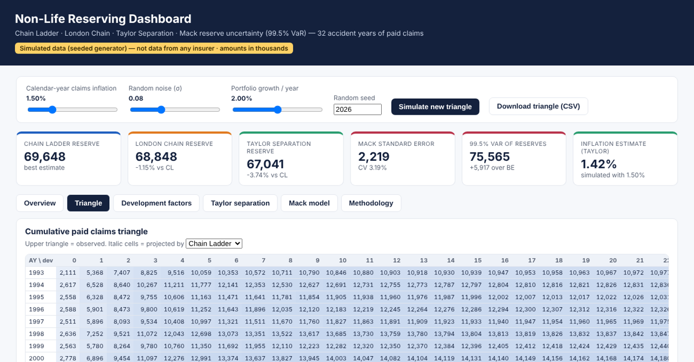

# Non-Life Reserving Dashboard – Chain Ladder, London Chain, Taylor Separation, Mack

**Live demo:** https://kchikachriyane.github.io/actuarial-projects/Non-Life-Reserving-Dashboard/

Interactive dashboard that estimates outstanding claims on a 32-accident-year paid triangle with three deterministic methods, then measures reserve uncertainty with the Mack model and a 99.5% Value-at-Risk (the Solvency II calibration level).

It mirrors the work I did during my non-life reserving internship, rebuilt from scratch on **simulated data**: the triangle is generated by a seeded random generator, so it contains no data from any insurer.

## What you can do

- Change the claims inflation, noise and portfolio growth used to simulate the triangle, or draw a new one, and see every result update.
- Compare total and per-accident-year reserves from Chain Ladder, London Chain and Taylor Separation.
- See the full triangle with projected cells, the development factors, the Taylor calendar-year indices and the Mack standard errors.
- Download the simulated triangle as CSV.

## Methods

| Method | What it adds |
| --- | --- |
| Chain Ladder | Volume-weighted development factors applied to the latest diagonal |
| London Chain (Benjamin & Eagles) | Development step with an intercept, `C(j+1) = λj·C(j) + αj`, fitted by least squares |
| Taylor arithmetic separation | Splits payments per claim into development proportions `rj` and calendar-year indices `λk`; a log-linear trend on `λk` gives an explicit claims-inflation estimate |
| Mack (1993) | Distribution-free standard error of the Chain Ladder reserve, per accident year and in total; log-normal fit gives the 99.5% VaR and a 95% interval |

## Checks

- **Mack benchmark:** the implementation reproduces the published Taylor–Ashe results (total reserve 18,680,856, standard error 2,447,095).
- **Inflation recovery:** with data simulated at 1.5% calendar-year inflation, the Taylor separation method estimates 1.42%.

## Results with the default settings (seed 2026, thousands)

| Metric | Value |
| --- | --- |
| Chain Ladder reserve | 69,648 |
| London Chain reserve | 68,848 (−1.2%) |
| Taylor separation reserve | 67,041 (−3.7%) |
| Mack standard error | 2,219 (CV 3.2%) |
| 99.5% VaR of reserves | 75,565 |

## Files

- `index.html` – the whole dashboard (open it in a browser, no installation)
- `engine.js` – the reserving engine on its own (simulation, Chain Ladder, London Chain, Taylor separation, Mack), usable from Node.js

**Tools:** JavaScript, Chart.js · **Author:** Riyane Kchikach · [LinkedIn](https://www.linkedin.com/in/riyanekchikach)
