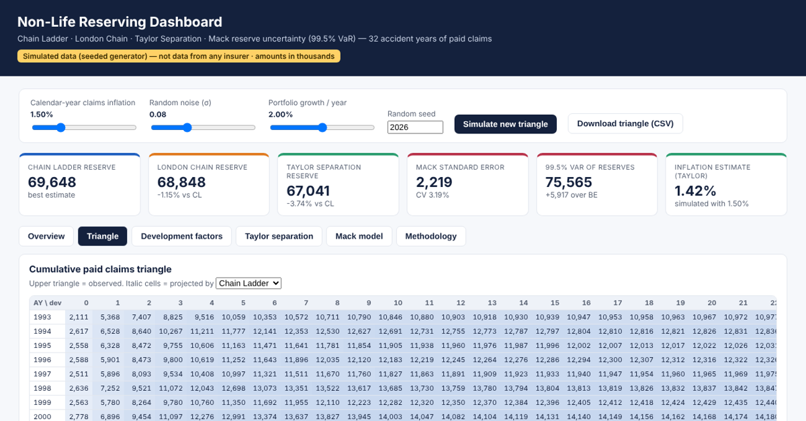

# Actuarial & Risk Projects

Actuarial modelling projects by **Riyane Kchikach**: MSc Finance & Actuarial Science (University Hassan I, June 2027), actuarial intern in non-life reserving at RMA (2026).

The projects cover the core work of a graduate actuarial analyst: reserving, reserve uncertainty, asset-liability management and insurance analytics.

**▶ [Open the live reserving dashboard](https://kchikachriyane.github.io/actuarial-projects/Non-Life-Reserving-Dashboard/)**: runs in the browser, nothing to install.

[](https://kchikachriyane.github.io/actuarial-projects/Non-Life-Reserving-Dashboard/)

## Projects

| Project | What it does | Methods | Stack |
| --- | --- | --- | --- |
| [Non-Life Reserving Dashboard](Non-Life-Reserving-Dashboard/) · [live](https://kchikachriyane.github.io/actuarial-projects/Non-Life-Reserving-Dashboard/) | Simulates a 32-accident-year paid claims triangle and compares reserving methods, with reserve uncertainty | Chain Ladder, London Chain, Taylor separation, Mack (validated on Taylor–Ashe), log-normal 99.5% VaR | JavaScript, Chart.js |
| [Stochastic Reserving Dashboard](Stochastic-Reserving-Dashboard/) | Reserving on a 9-accident-year triangle with premiums | Chain Ladder vs Bornhuetter-Ferguson, Mack variances, log-normal reserve distribution, 99.5% VaR | JavaScript, Chart.js |
| [ALM Stochastic Simulator](ALM-Stochastic-Simulator/) | Projects assets and liabilities over 30 years across 5,000 economic scenarios | Vasicek short rates, correlated GBM equities (Cholesky), surplus and funding ratio, 99.5% VaR, +200 bp rate shock | Python, NumPy, pandas, Matplotlib |
| [Car Insurance Premium Dashboard](Car-Insurance-Premium-PowerBI/) | Premium drivers across 1,000 synthetic motor policies | Driver age, accident history, vehicle age, mileage | Power BI, DAX |
| [Health Insurance Charges Dashboard](Health-Insurance-Charges-PowerBI/) | How age, sex, children and region drive medical charges | Descriptive risk-factor analysis | Power BI, DAX |

## Data

No project contains real policyholder or company data.

- The Non-Life Reserving Dashboard uses a seeded simulator (inflation, growth and noise are adjustable).
- The Stochastic Reserving Dashboard uses a triangle with altered figures, provided for training during my internship; it does not reflect any insurer's actual results.
- The ALM simulator generates its own scenarios; the Power BI dashboards use public or synthetic datasets.

## Run locally

```bash
git clone https://github.com/kchikachriyane/actuarial-projects.git
cd actuarial-projects

# Reserving dashboard: open Non-Life-Reserving-Dashboard/index.html in any browser

# ALM simulator
cd ALM-Stochastic-Simulator
pip install -r requirements.txt
python main.py
```

The Power BI reports (`.pbix`) open in Power BI Desktop; screenshots are in each folder.

## Contact

Looking for a **Graduate Actuarial Analyst** role from September 2027 (UK, Ireland, Europe, Canada).

[LinkedIn](https://www.linkedin.com/in/riyanekchikach) · riyane.kchikach@outlook.com

Code is released under the [MIT License](LICENSE).
