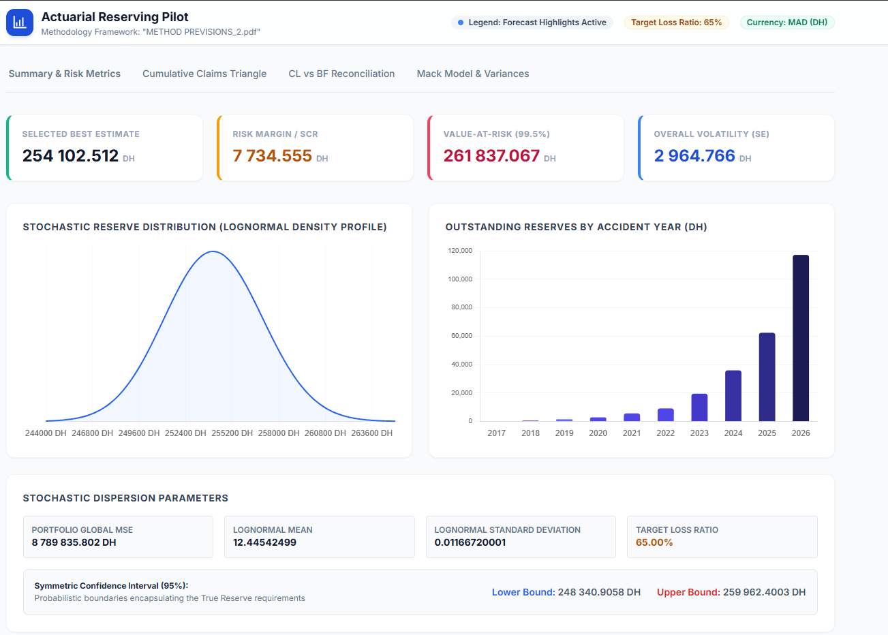
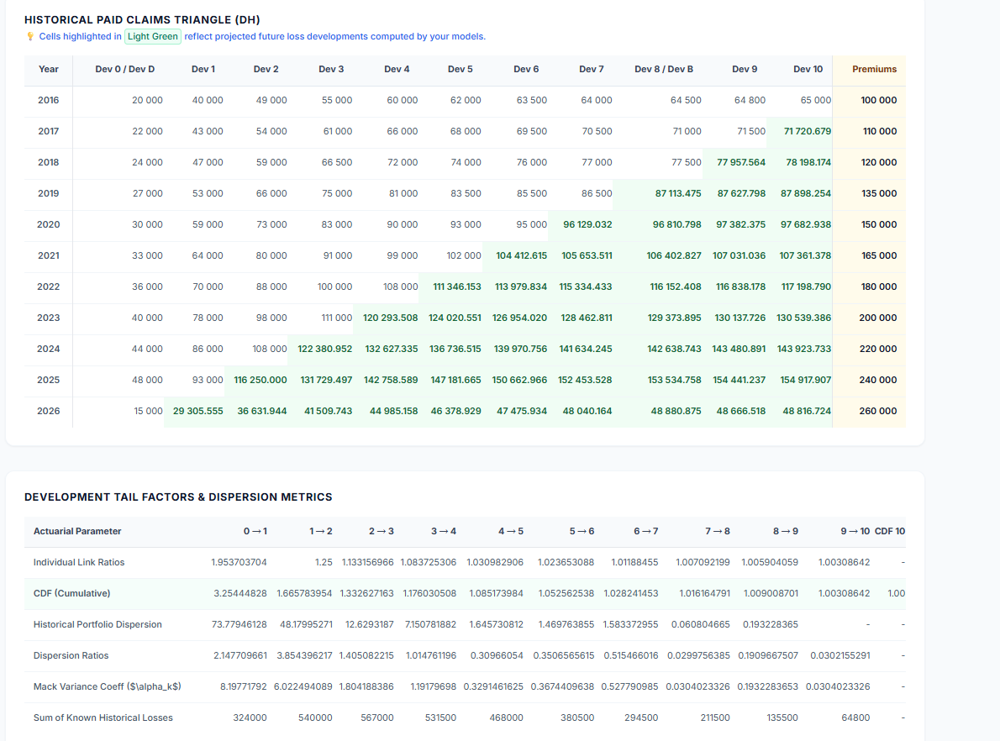
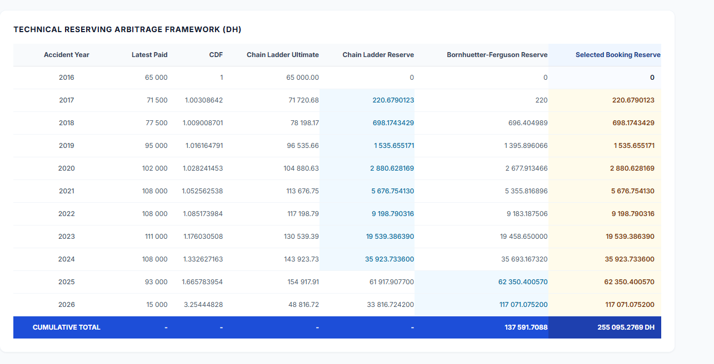
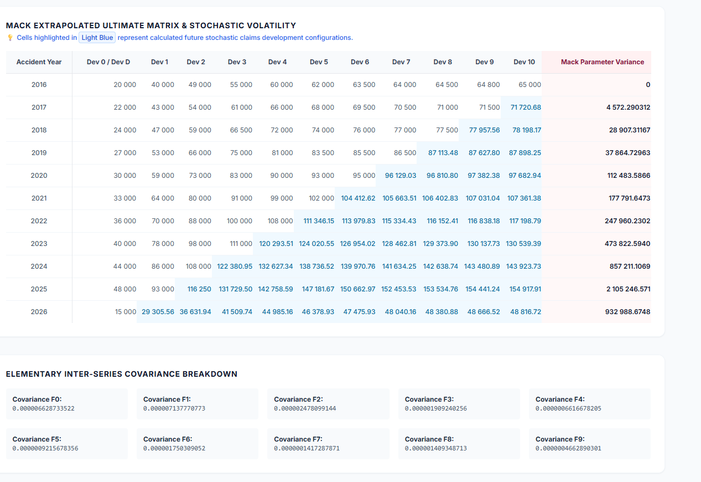

# Stochastic Reserving Dashboard (Chain Ladder, Bornhuetter-Ferguson, Mack)

Interactive non-life reserving dashboard that takes a paid claims triangle and produces best-estimate reserves, a comparison of methods and a measure of reserve uncertainty.

**Data:** a 9-accident-year triangle (2016–2024) with premiums, in MAD, with altered figures, provided for training during my internship. It does not reflect any insurer's actual results.

## What it does

| Tab | Content |
| --- | --- |
| Summary & risk metrics | Selected best estimate, risk margin, 99.5% Value-at-Risk, standard error, reserves by accident year, log-normal reserve distribution |
| Cumulative claims triangle | Paid triangle with projected cells highlighted, premiums by accident year |
| Chain Ladder vs Bornhuetter-Ferguson | Latest paid, cumulative development factors, ultimates and reserves by accident year for both methods (target loss ratio 65%), selected reserve |
| Mack model & variances | Projected lower triangle and Mack parameter / process variance by accident year |

## Methods

- **Chain Ladder:** volume-weighted development factors, ultimate claims and IBNR.
- **Bornhuetter-Ferguson:** a priori ultimate from premium × expected loss ratio (65%), credibility-weighted with the Chain Ladder development pattern.
- **Mack (1993):** distribution-free standard error of the Chain Ladder reserve (process + parameter variance), per accident year and in total.
- **Reserve risk:** log-normal distribution fitted to the Mack mean and standard error; 99.5% quantile (Solvency II calibration level).

## Results (illustrative data)

| Metric | Value (MAD) |
| --- | --- |
| Selected best estimate | 254,102.51 |
| Standard error (Mack) | 2,964.77 |
| 99.5% VaR of reserves | 261,837.07 |
| Risk margin (VaR − best estimate) | 7,734.56 |

## Screenshots

**Tools:** HTML5, JavaScript, Tailwind CSS, Chart.js
**Author:** Riyane Kchikach · [LinkedIn](https://www.linkedin.com/in/riyanekchikach)
